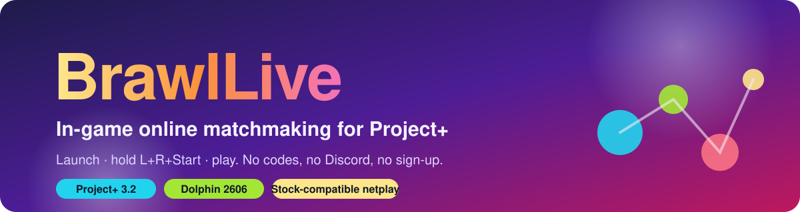
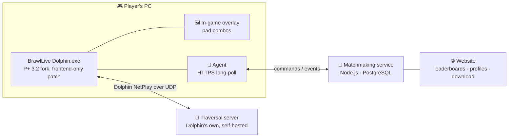

<p align="center">
  
</p>

<p align="center">
  
  
  
  
  
</p>

<h1 align="center">🥊 BrawlLive</h1>
<p align="center"><b>Press a button on your pad. Get a match. Play.</b><br>
Online matchmaking for <a href="https://projectplusgame.com">Project+</a> that lives inside the game window, on the official netplay build.</p>

---

## 🎯 Why

Project+ is where competitive Brawl lives, and getting a game still means posting host codes in Discord and waiting. Slippi showed what happens when matchmaking moves into the game itself: a community forms around the queue. BrawlLive brings that loop to P+ without waiting for rollback netcode and without breaking compatibility with anyone on the stock build.

## 🎮 What the player does

| Step | What happens |
|---|---|
| 1️⃣ **Install once** | Run the installer. It swaps one file, `Dolphin.exe`, inside your existing P+ 3.2 folder and keeps the original as a backup. No account, no sign-up. |
| 2️⃣ **Launch P+ as usual** | A small BrawlLive overlay appears in the game window. |
| 3️⃣ **Hold L + R + Start** | The menu opens: Casual or Ranked, Singles or Doubles. Pick with the D-pad, confirm with A. |
| 4️⃣ **Keep playing while you wait** | CPU matches, training, whatever. The overlay shows the search. |
| 5️⃣ **Match found** | Opponent and ping on screen, a short countdown, then Dolphin restarts straight into the netplay session with the buffer already set. |
| 6️⃣ **After the game** | Rematch or requeue from the same overlay. |

> 🧩 **Stock-compatible.** BrawlLive players can still join ordinary P+ 3.2 lobbies by code. The patched build changes nothing in the emulation core, and CI enforces that.

## 🏗️ How it works



- **Agent in Dolphin.** A headless client long-polls the service for `host`, `join` and `start` commands and reports `hosting`, `player_joined`, `game_started`, `game_ended`.
- **Overlay.** Drawn with the same ImGui layer Dolphin uses for netplay chat, driven by the emulated pad state so GameCube adapters work with zero setup.
- **Service.** Queues, pairing by region, ping band and rating, a match state machine with a timeout and recovery for every stage.
- **Identity.** Zero-signup device identity. Discord linking comes later and may be required for ranked.

## 🗺️ Roadmap

| # | Sub-project | Status |
|---|---|---|
| 1 | 🔧 **Dolphin build**: agent, overlay, combos, installer, stub server, CI | 🟡 planned, [14 tasks ready](docs/superpowers/plans/2026-10-15-brawllive-dolphin-build.md) |
| 2 | 🧠 **Matchmaking service core**: casual singles, pairing, host-code relay, traversal server | ⚪ next |
| 3 | 🌐 **Website**: download, guide, status, leaderboards | ⚪ |
| 4 | 🏆 **Ranked**: ratings, result claims and disputes, then in-emulator result capture | ⚪ |
| 5 | 👥 **Doubles**: four-player sessions, team queue | ⚪ |
| 6 | 🚀 **Operations and launch**: EU VPS, monitoring, beta | ⚪ |

Later: a native "Online" entry in the P+ menus via a custom EXI device, Discord account linking, macOS and Linux builds.

## 📦 Repositories

| Repo | Contents |
|---|---|
| [`brawllive`](https://github.com/NoobyGains/brawllive) (this one) | Service, website, tools, docs, plans |
| [`brawllive-dolphin`](https://github.com/NoobyGains/brawllive-dolphin) | Fork of [Project-Plus-Dolphin](https://github.com/Project-Plus-Development-Team/Project-Plus-Dolphin) at `v3.2.0` carrying the BrawlLive patch, CI and releases (GPL-2.0-or-later) |

## 🗂️ Layout

```
brawllive/
├── docs/
│   ├── superpowers/specs/     design spec (approved)
│   ├── superpowers/plans/     implementation plans, one per sub-project
│   └── assets/                banner and images
├── tools/
│   ├── stub-service/          zero-dependency Node stub that speaks protocol v1 (SP1)
│   ├── installer/             PowerShell install / uninstall scripts (SP1)
│   └── milestone/             two-instance end-to-end harness (SP1)
├── service/                   matchmaking service (SP2)
├── web/                       website (SP3)
└── ops/                       Docker Compose, VPS, backups, monitoring (SP6)
```

## 🛠️ Workers: start here

1. Read the **spec**: [`docs/superpowers/specs/2026-10-15-brawllive-matchmaking-design.md`](docs/superpowers/specs/2026-10-15-brawllive-matchmaking-design.md).
2. Read the **plan** for the sub-project you are on. Sub-project 1 is [`docs/superpowers/plans/2026-10-15-brawllive-dolphin-build.md`](docs/superpowers/plans/2026-10-15-brawllive-dolphin-build.md): 14 tasks, each with failing test, implementation, verification and commit steps.
3. Pick the matching **issue** from the [issue tracker](https://github.com/NoobyGains/brawllive/issues). Tasks are sequential inside the fork; the stub server and installer tasks run in parallel.
4. Hard rules, enforced by CI:
   - never change anything under `Source/Core/Core/` in the fork except the BrawlLive config pair;
   - the built exe advertises the upstream P+ commit `448d1dbe` as its netplay identity;
   - no game files, saves or ISOs in any repo or artifact, ever.

Prerequisites on the build machine: Visual Studio 2022 Build Tools (v143), Windows SDK 10.0.26100, git, Node.js 24.12 or newer, PowerShell 7.

```powershell
# Dolphin fork (after Task 1 lands)
pwsh -File build.ps1 -Tests

# Stub matchmaking server and its tests (Task 7)
cd tools/stub-service && node --test server.test.ts

# Installer tests (Task 12)
pwsh -File tools/installer/Install-BrawlLive.Tests.ps1
```

## ❓ FAQ

**Do I need a new P+ install?** No. One file is replaced inside your existing P+ 3.2 folder, and the installer keeps the original.

**Will I still be able to play friends on the normal build?** Yes. The netplay handshake sees the same version as stock P+ 3.2.

**Is there rollback?** No. BrawlLive runs on the official P+ lockstep netcode, so a found match ends with a short restart into the session. Rollback efforts for Brawl exist elsewhere; BrawlLive does not depend on them.

**Where do I get the game?** From your own disc. BrawlLive never distributes or touches game files.

## 🙏 Credits

[Project+ Development Team](https://projectplusgame.com) for the mod and its Dolphin fork · [Dolphin Emulator](https://dolphin-emu.org) · [Slippi](https://slippi.gg) for proving the in-game queue · [Brawlback](https://github.com/Brawlback-Team) and [Mario Party Netplay](https://github.com/MarioPartyNetplay) for paving the road.

<p align="center"><sub>License for this repository is still to be decided; the Dolphin fork is GPL-2.0-or-later.</sub></p>
